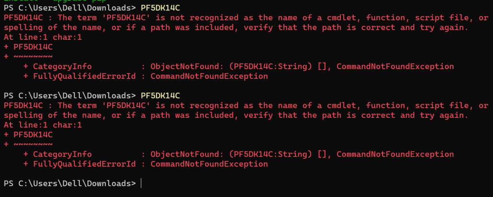
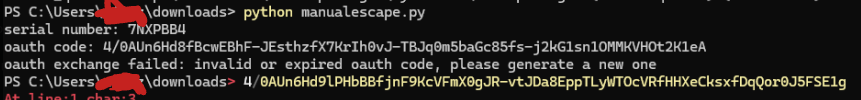

## what you should not do while running manualescape (with examples from actual skids)

  - did not run the script and just typed in the serial number
  - also in powershell when meant to be in cmd (command prompt)

  - did not rerun the script and instead just pasted the new oauth_code
